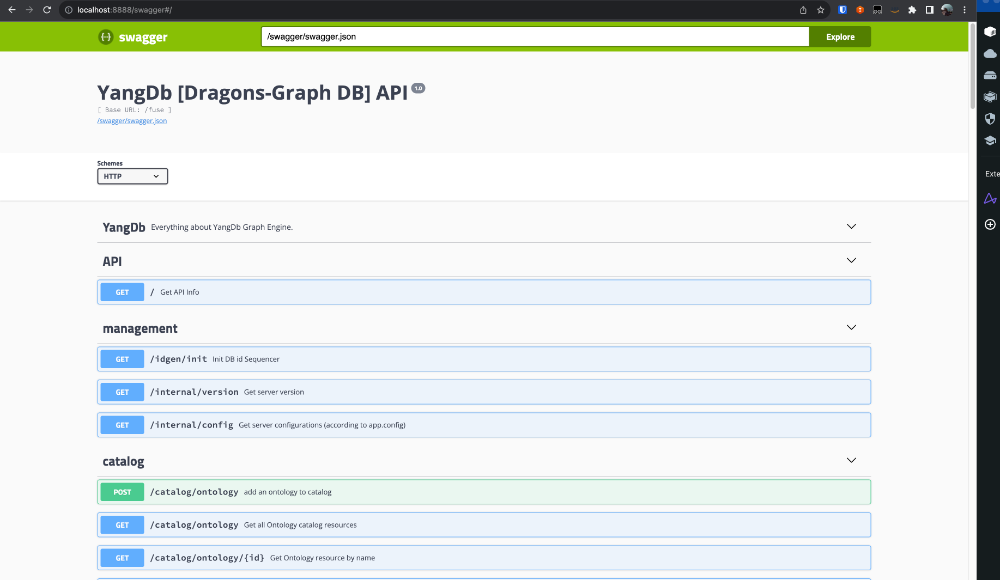

# Running The Dragons Graph
This is the quickstart for YANG-DB: it runs the Dragons sample graph on top of OpenSearch using docker compose.

[docker-compose-os.yml](docker-compose-os.yml) starts three services:
 - OpenSearch 1.3.0 (single node, security plugin disabled - for local testing only)
 - OpenSearch Dashboards 1.3.0
 - Fuse - the YANG-DB graph engine, preloaded with the Dragons ontology

## Prerequisites
- Docker with the `docker compose` plugin
- JDK 11 and Maven 3.6+ (the image is built locally - there is no current prebuilt image on Docker Hub)

The OpenSearch version is set by `OS_VERSION` in [.env](.env) and must match `<opensearch.version>` in the root `pom.xml`.

## Building
From this `docker/` folder run:
```bash
chmod +x buildDocker.sh
./buildDocker.sh Dragons
```

This will:
- Run the maven build (`mvn clean install -DskipTests=true -P core,dragons-assembly`)
- Generate the `distrib/dragon` folder, which holds the jars and the start script for the graph engine (Fuse)
- Build the docker image `yangdb/yang.db:Dragons` from that folder

## Running the Docker-compose services
```bash
docker compose -f docker-compose-os.yml up -d
```
This starts:
 - OpenSearch - http://localhost:9200
 - OpenSearch Dashboards - http://localhost:5601
 - Fuse (graph engine) - http://localhost:8888

Fuse waits for OpenSearch to report healthy before starting. Check it's up with:
```bash
curl http://localhost:8888/fuse/health
```
Then open http://localhost:8888/swagger# to explore the API.

To stop everything: `docker compose -f docker-compose-os.yml down` (add `-v` to also delete the data volumes).

## Swagger API
The next API references allows access to all the Graph's functionality and configuration.
 - See [Docs](../docs/info/api.md)



### Calling the Get Info API
Run `curl http://localhost:8888/fuse`, or navigate to `http://localhost:8888/swagger#/API/get_` and call `execute`.

The next response is expected:
```json5
{
  "requestId": "FR870994186772480000",
  "elapsed": "00000080",
  "renderElapsed": "00000313",
  "totalElapsed": "00000393",
  "data": {
    "resourceUrl": "/fuse",
    "resourceId": null,
    "healthUrl": "/fuse/health",
    "internal": "/fuse/internal",
    "queryStoreUrl": "http://172.27.0.4:8888/fuse/query",
    "searchStoreUrl": "/fuse/search",
    "catalogStoreUrl": "http://172.27.0.4:8888/fuse/catalog/ontology"
  }
}
```
## Dragons Tutorial
For more advanced usage and tutorial please refer to the [Tutorials folder](../docs/tutorial)
- [Dragons Tutorial Ontology](../docs/tutorial/sample/dragons/create-ontology.md)
- [Dragons Tutorial Data](../docs/tutorial/sample/dragons/load-data.md)
- [Dragons Tutorial Query](../docs/tutorial/sample/dragons/query-the-data.md)
- [Dragons Tutorial Projections](../docs/tutorial/sample/dragons/projection-and-count.md)