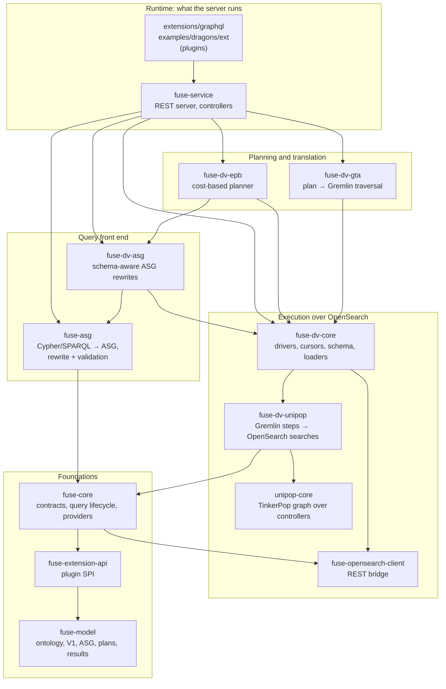

# The modules

[← Architecture tutorial](README.md) · next: [The life of a query](query-lifecycle.md)

YANG-DB is a Maven reactor of about 20 modules and ~1,280 main Java files. This page says what each module is for,
which classes to read first, and how the modules depend on each other. Paths are relative to the repository root;
every Java package starts with `com.yangdb.fuse` unless shown otherwise.

## The big picture

Arrows point from a module to what it depends on (compile scope, simplified). The layering, bottom to top:

| Layer | Modules |
|---|---|
| L0, no in-repo dependencies | `unipop-core`, `fuse-geojson`, `fuse-opensearch-client`, `fuse-model` |
| L1 | `fuse-extension-api` → model · `fuse-test-framework` → client, model · `fuse-dv-stat` → client |
| L2 | `fuse-core` → model, extension-api, geojson, client |
| L3 | `fuse-asg` → model, core · `fuse-dv-unipop` → geojson, unipop-core, model, core |
| L4 | `fuse-dv-core` → model, core, client, dv-unipop |
| L5 | `fuse-dv-asg` → …, dv-core, asg · `fuse-dv-gta` → …, dv-core |
| L6 | `fuse-dv-epb` → …, dv-asg, dv-core, dv-stat |
| L7 | `fuse-service` → asg, dv-asg, core, extension-api, dv-epb, dv-core, dv-gta |
| L8 | `extensions/graphql`, `examples/dragons/ext` → service and below |
| L9 | `distribution` → everything (packaging only) |

## Build profiles

Modules are only declared inside profiles in the root `pom.xml`:

- **`core`** (active by default): every engine module, `fuse-test`, and `extensions`.
- **`examples`**: `examples/dragons/ext` and `examples/dragons/datagen`.
- **`dragons-assembly`**: `examples` plus `distribution`, which builds the runnable server into `distrib/dragon`.

Naming any profile with `-P` turns the default one off, so build the distribution with `-P core,dragons-assembly`.

---

## Foundations

### fuse-model: the shared vocabulary
Data classes only, no service logic. Every other module speaks in these types.

| What | Where (`fuse-model/src/main/java/com/yangdb/fuse/model/`) |
|---|---|
| **Ontology**, the logical schema: entity types, relationship types, properties, enums | `ontology/Ontology.java`, with `Ontology.Accessor`, the read API used during query processing |
| **IndexProvider**, the physical schema: which index or partition holds each type | `schema/IndexProvider.java`, `Entity`, `Relation`, `Props`, `Redundant` |
| **V1 query**, the native JSON query language: a flat list of numbered elements | `query/Query.java`, `query/Start`, `query/entity/ETyped|EUntyped|EConcrete`, `query/Rel`, `query/quant/Quant1`, `query/properties/EProp|EPropGroup|RelProp` |
| **ASG**, the query as a tree, used by every later stage | `asgQuery/AsgQuery.java`, `asgQuery/AsgEBase.java` (wraps one V1 element and links it to its children) |
| **Execution plans** | `execution/plan/composite/Plan.java` (a list of `PlanOp`s: `EntityOp`, `EntityFilterOp`, `RelationOp`, `RelationFilterOp`, `GoToEntityOp`, …), `execution/plan/PlanWithCost.java` |
| **REST requests and responses** | `transport/CreateQueryRequest`, `CreateJsonQueryRequest`, `transport/cursor/*` (one request class per cursor type), `resourceInfo/QueryResourceInfo` |
| **Results** | `results/AssignmentsQueryResult`, `Assignment`, `Entity`, `Relationship`, `Property` |

It also publishes a test-jar that many modules use in their tests.

### fuse-extension-api: the plugin contract
A deliberately small module (5 classes) that outside plugins compile against, so they don't depend on the server's
internals.

- `extension/YangDbExtension.java`: the `ServiceLoader` interface. An extension supplies `modules()` (Guice),
  `joobyModules()` and `registrars()` (REST routes).
- `extension/QueryLanguages.java`: a Guice `MapBinder` from language name to a
  `QueryTransformer<QueryInfo<String>, AsgQuery>`. Registering a language is one line:
  `QueryLanguages.register(binder, "mylang").to(MyTransformer.class)`.
- `services/appRegistrars/AppRegistrar.java` and `dispatcher/urlSupplier/AppUrlSupplier.java` let extensions add routes.

### fuse-core: contracts and the query lifecycle
The "dispatcher" layer. It holds mostly interfaces and base classes that `fuse-dv-*` implements:

- **The query lifecycle**: `dispatcher/driver/QueryDriverBase.java` runs create → transform → rewrite → validate → plan
  → cursor → page. It also implements `run`, `explain`, `profile`, `findPath`, `getNeighbors` and related calls.
  `CursorDriverBase` and `PageDriverBase` are the matching cursor and page halves.
- **Planner and translator SPIs**: `dispatcher/epb/PlanSearcher`, `PlanExtensionStrategy`, `PlanPruneStrategy`,
  `PlanSelector`, `CostEstimator`, and `dispatcher/gta/PlanTraversalTranslator`.
- **Cursors**: `dispatcher/cursor/CursorFactory`, and `CompositeCursorFactory`, which picks the implementation for a
  cursor request class.
- **Providers**: `dispatcher/ontology/DirectoryOntologyProvider` loads every ontology JSON from a directory, and
  `DirectoryIndexProvider` loads the index providers.
- **V1 → ASG**: `dispatcher/asg/QueryToAsgTransformer` and `QueryToCompositeAsgTransformer`.
- **Resources**: `dispatcher/resource/store/*`. Queries, cursors and pages are resources addressed by URL.
- **Guice plumbing**: `dispatcher/modules/ModuleBase`, a module that only activates when the config lists it, and
  `CoreDispatcherModule`.
- **Schema importers**: SQL DDL → ontology (jOOQ, `dispatcher/query/sql`) and OWL → ontology (`dispatcher/query/rdf`).
- **A Java REST client** for the service: `client/FuseClient`, `BaseFuseClient`.

### fuse-geojson
A vendored GeoJSON model (`org.geojson.*`) with Jackson serializers. Used for `geo_point` properties and geo
predicates.

## Query front end

### fuse-asg: text → ASG, rewrite, validation
- **Cypher** (`asg/translator/cypher/`): `AsgCypherModule` registers the `cypher` language; `AsgCypherTransformer`
  calls `CypherTranslator`. Parsing uses the openCypher **front-end 9.0** parser (Scala, `org.opencypher:front-end-9.0`).
  The `strategies/` package walks the parsed statement and builds ASG elements directly.
- **SPARQL** (`asg/translator/sparql/`): `AsgSparqlModule`, `SparqlTranslator`, parsed with Eclipse rdf4j.
- **Rewrite**: `asg/AsgQueryTransformer` applies an ordered list of `AsgStrategy` (`asg/strategy/**`): type inference
  for untyped nodes, property grouping, constraint normalisation, default projections, and more.
- **Validation**: `asg/validation/AsgQueryValidator` with one strategy per rule, such as entity and relationship
  existence in the ontology, property types, cycles and steps.
- `asg/translator/BasicJsonQueryTransformerFactory`: looks a language name up in the `QueryLanguages` map.

### fuse-dv-asg: rewrites that need the physical schema
ASG strategies that depend on how a field is indexed, so they can't live in `fuse-asg`. For example,
`ExactConstraintTransformationAsgStrategy` sends an equality on a `text` property to its exact-match `.keyword`
sub-field. It also holds **`M2AsgModule`**, the ASG module the shipped configuration uses, and
`M2AsgStrategyRegistrar`, the ordered strategy list.

## Planning and translation

### fuse-dv-epb: the cost-based planner
EPB, the Execution Plan Builder, turns an ASG into the cheapest **plan**: an ordered list of operations that says
which entity to start from and which way to walk each relationship.

- `epb/plan/BottomUpPlanSearcher`: grows partial plans step by step. On each step it extends them, validates them,
  costs them, prunes them and selects among them. `UnionPlanSearcher` and `OptionalSplitPlanSearcher` handle `UNION`
  and `OPTIONAL`.
- `epb/plan/extenders/**`: how a partial plan can grow. The shipped configuration uses
  `M1/M1DfsRedundantPlanExtensionStrategy`.
- **Cost**: the shipped Dragons configuration (`EpbDfsCountBasedRedundantModule`) uses `estimation/count/CountCostEstimator`.
  It costs a short partial plan by **running a count query against OpenSearch**, cached for 10 minutes. The
  statistics-based estimators (`estimation/pattern/**` with a `StatisticsProvider`) are the alternative modules.
- `epb/plan/validation/M1PlanValidator`, `pruners/*`, `selectors/*`.

### fuse-dv-gta: plan → Gremlin traversal
GTA turns a plan into a TinkerPop `GraphTraversal`, with one translation strategy per plan-operation type.

- `gta/translation/discrete/M1PlanTraversalTranslator` (configured) extends `ChainedPlanOpTraversalTranslator`. It
  folds each `PlanOp` into the traversal.
- `gta/strategy/discrete/*`: `EntityOpTranslationStrategy`, `EntityFilterOpTranslationStrategy`,
  `RelationOpTranslationStrategy`, `RelationFilterOpTranslationStrategy`, `CountOpTranslationStrategy`,
  `OptionalOpTranslationStrategy`, and `common/GoToEntityOpTranslationStrategy`.

### fuse-dv-stat: offline statistics
A standalone tool (`stat/StatCalculator`, with its own `main`). It computes histograms of field values (numeric,
string, term, manual, dynamic and composite buckets) using OpenSearch aggregations, and writes them to a `stat`
index. The statistics-based cost estimators read that index. The shipped Dragons setup uses count-based costing
instead, so it doesn't need this.

## Execution over OpenSearch

### fuse-dv-core: the engine's implementation
- **Drivers**: `core/driver/StandardQueryDriver` (runs the planner while creating a query resource),
  `StandardCursorDriver` (translates the plan into a traversal when a cursor is created) and `StandardPageDriver` (runs
  the traversal when a page is requested).
- **Cursors** (`executor/cursor/discrete/`): one class per result shape, bound in `executor/modules/discrete/CursorsModule`:

  | Cursor type | Class | Returns |
  |---|---|---|
  | `forwardPaths` (default) | `ForwardOnlyPathsTraversalCursor` | assignments, one per matched path |
  | `paths` | `PathsTraversalCursor` | the same, without the forward-only optimisation |
  | `graph` | `GraphTraversalCursor` | the matched subgraph |
  | `count` | `CountTraversalCursor` | counts only |
  | `csv` | `CsvTraversalCursor` | CSV rows |
  | `findPaths` | `FindPathsTraversalCursor` | path search between entities |
  | `graphHierarchy`, `hierarchyFlatten` | `NewGraphHierarchyTraversalCursor`, `HierarchyFlattenCursor` | nested and flattened graph views |
  | `projection` | `IndexProjectionCursor` | writes results into the `projection` index |
  | `inner` | `InnerQueryCursor` | results of a sub-query, used by composite queries |

- **Physical schema**: `executor/ontology/schema/GraphElementSchemaProviderJsonFactory` turns ontology + IndexProvider
  into the `GraphElementSchemaProvider` the unipop layer uses. That provider maps types to indices and partitions,
  edges to their two ends, and declares redundant fields. `IndexProviderRawSchema` lists the indices.
- **Index creation and loading** (`executor/ontology/schema/load/`): `DefaultGraphInitiator` (`/fuse/load/.../init`)
  creates templates and indices with `executor/opensearch/ElasticIndexProviderMappingFactory`.
  `IndexProviderBasedGraphLoader` loads JSON graphs, and `IndexProviderBasedCSVLoader` with `CSVTransformer` loads CSV.
  Every relationship is stored **twice**, once per direction (see [the life of a query](query-lifecycle.md#how-the-data-is-stored)).
- **Wiring**: `executor/ExecutorModule` binds the drivers, the OpenSearch client (through `executor/opensearch/ClientProvider`),
  the resource store, the schema providers and the graph provider. `executor/ontology/discrete/M1ElasticUniGraphProvider`
  builds the graph.
- **Persistent stores**: `executor/resource/PersistentResourceStore` keeps stored queries in the `fuse_system` index.
  `PersistantNodeStatusResource` keeps service-node heartbeats in `fuse_node_info`.

### fuse-dv-unipop: Gremlin steps → OpenSearch searches
The OpenSearch backend for `unipop-core`.
- `unipop/structure/FuseUniGraph`: the graph the traversals run on.
- **Controllers** (`unipop/controller/discrete/`): `DiscreteElementVertexController` finds vertices.
  `DiscreteVertexController` finds edges from a batch of vertices. `DiscreteVertexFilterController` fetches and filters
  the vertices at the far end. `DiscreteElementReduceController` counts. A second, "promise" family
  (`controller/promise/`) also exists.
- **Search building** (`unipop/controller/common/appender/`, `controller/search/`): a chain of *search appenders*
  fills a `SearchBuilder`. Some pick the indices, some set the size, and `ConstraintSearchAppender` translates the
  Gremlin constraint into an OpenSearch bool query. `EdgeBulkSearchAppender` restricts a search to the current batch
  of vertex ids.
- **Results**: `converter/SearchHitScrollIterable` scrolls through hits, and `DiscreteVertexConverter` and
  `DiscreteEdgeConverter` turn hits back into vertices and edges.
- `unipop/schemaProviders/**`: the physical-schema model (`GraphVertexSchema`, `GraphEdgeSchema`, index partitions,
  including time-based ones).
- `unipop/process/traversal/strategy/FuseStandardStrategyProvider`: the TinkerPop strategies that replace standard
  steps with unipop steps.

### unipop-core
A vendored fork of the Unipop library (`org.unipop.*`). It implements TinkerPop 3.2.5's `Graph` (`UniGraph`) by
sending steps to pluggable controllers instead of an in-memory store. Its steps (`UniGraphStartStep`,
`UniGraphVertexStep`, …) work in batches, so one OpenSearch search serves many traversers at once.

### fuse-opensearch-client: the REST bridge
OpenSearch 2.x removed the transport client. `opensearch/client/RestBridgeClient` keeps the old `Client` interface
the engine was written against, and runs each action over HTTP with the REST high-level client: search, scroll, bulk,
index, get, templates and the rest. `ClientFactory.remote(hosts, httpPort, settings)` builds it. See
`fuse-opensearch-client/README.md`.

## Runtime

### fuse-service: the REST server
- `services/FuseRunner` (`main`) loads the config, then starts `services/FuseApp`, a Jooby 1.x app on Netty under
  `/fuse`.
- `services/modules/Bootstrap` instantiates the Guice modules listed under `modules.<profile>` in the config (see
  *Configuration* below). `services/extensions/YangDbExtensions` discovers plugins with `ServiceLoader`.
- **Routes** (`services/appRegistrars/`, one registrar per group) and **controllers** (`services/controllers/Standard*`,
  each wrapped by a `Logging*` decorator):

  | Group | Registrar | Examples |
  |---|---|---|
  | `/fuse/query` | `QueryControllerRegistrar` | `POST /fuse/query` (V1), `/fuse/query/cypher[/run]`, `/fuse/query/:id/asg/print`, `/plan/print` |
  | `/fuse/query/:lang` | `QueryLanguageRoutesRegistrar` | any registered language: `POST /fuse/query/:lang`, `GET|POST /fuse/query/:lang/run` |
  | cursors, pages | `CursorControllerRegistrar`, `PageControllerRegistrar` | `/fuse/query/:id/cursor/:cursorId/page/:pageId/data` |
  | `/fuse/catalog` | `CatalogControllerRegistrar` | ontologies, and the physical schema per ontology |
  | `/fuse/load` | `DataLoaderControllerRegistrar` | `init`, `drop`, `graph/load`, `csv/load` |
  | `/fuse/idgen`, `/fuse/internal`, `/fuse/dashboard` | … | id ranges, version and config, simple dashboards |

- `services/embedded/ElasticEmbeddedNode`: an in-process OpenSearch node, started when `opensearch.embedded = true`.

### extensions/graphql
The first real plugin. `GraphQLExtension` (registered in `META-INF/services`) contributes:
- `GraphQLModule`, which registers the `graphQL` language → `AsgGraphQLTransformer`
- a GraphQL cursor
- the routes `/fuse/query/graphQL[/run]` (the language key is spelled `graphQL`) and `POST /fuse/graphql/ontology/:id`,
  which imports a GraphQL SDL schema as an ontology

It uses graphql-java 24.

### examples/dragons
- **`ext`**: the Dragons sample domain's code. `DragonsModule` binds the index-provider directory and the id
  generator. `DragonsExtension` adds the playground (`/dragons/swagger`, with every tutorial query) and the one-click
  tutorial load (`POST /fuse/dragons/tutorial/load`).
- **`datagen`**: an offline generator for synthetic Dragons data (scale-free graphs, fake names). Nothing depends on it.

### distribution
Packaging only. `maven-assembly` copies the jars, the Dragons ontology, index provider and config from
`distribution/resources/assembly/Dragons/`, and `start-fuse-service.sh` into `distrib/dragon`. The Docker image and
the release download are built from that folder.

### fuse-test/fuse-test-framework
Test infrastructure:
- `ElasticEmbeddedNode` and `GlobalElasticEmbeddedNode`: an in-process OpenSearch for integration tests
- index and mapping configurers
- CSV and JSON data populators

`es-plugins/` is a leftover directory, not a module: no profile builds it.

---

## Configuration: how the pieces are chosen at runtime

The server is assembled from configuration, not hard-wired. The shipped config is
`distribution/resources/assembly/Dragons/config/application.test.engine3.m1.dfs.dragons.public.conf`, which becomes
`config/application.conf` in the distribution.

**Guice modules**, listed in this order under `modules.activeProfile`:

| Module | From | Provides |
|---|---|---|
| `ServiceModule`, `LoggingJacksonModule` | fuse-service | controllers, JSON rendering |
| `CoreDispatcherModule`, `DescriptorsModule` | fuse-core | URL supplier, ontology providers |
| `SparqlModule`, `SqlModule` | fuse-core | schema importers |
| `AsgCypherModule`, `AsgSparqlModule` | fuse-asg | the `cypher` and SPARQL languages |
| `M2AsgModule` | fuse-dv-asg | the ASG pipeline and the language registry |
| `EpbDfsCountBasedRedundantModule` | fuse-dv-epb | the planner, with count-based costs |
| `AsgValidationModule` | fuse-asg | validation |
| `GtaModule` | fuse-dv-gta | plan → traversal |
| `ExecutorModule`, `CursorsModule` | fuse-dv-core | drivers, client, schema, cursors |
| `DragonsModule` | examples/dragons/ext | the Dragons index providers and id generator |

GraphQL and the Dragons playground aren't in this list; they arrive through `ServiceLoader`.

**Implementation choices** are made by class name, keyed by `assembly = Dragons`:

| Key | Class |
|---|---|
| `Dragons.asg_strategy_registrar` | `M2AsgStrategyRegistrar` |
| `Dragons.plan_extension_strategy_class` | `M1DfsRedundantPlanExtensionStrategy` |
| `Dragons.stats_provider_class` | `NoStatsProvider` (costs come from counts, not statistics) |
| `fuse.plan_traversal_translator_class` | `M1PlanTraversalTranslator` |
| `Dragons.unigraph_provider` | `M1ElasticUniGraphProvider` |
| `Dragons.physical_schema_provider_factory_class` | `GraphElementSchemaProviderJsonFactory` |
| `Dragons.physical_schema_initiator`, `…_data_loader`, `…_csv_data_loader` | `DefaultGraphInitiator`, `IndexProviderBasedGraphLoader`, `IndexProviderBasedCSVLoader` |

**Where the schemas come from**: `fuse.ontology_provider_dir = ontology` (one JSON per ontology, e.g.
`ontology/Dragons.json`) and `fuse.index_provider_dir = indexProvider` (`indexProvider/DragonsIndexProvider.conf`).

**OpenSearch connection**: `opensearch.hosts`, `opensearch.http.port` (default 9200) and `opensearch.cluster_name`.
An old `opensearch.port = 9300` still works: it's read as HTTP port 9200.
