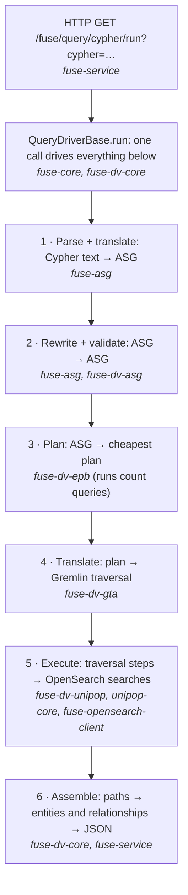

# The life of a query

[← Architecture tutorial](README.md) · previous: [The modules](modules.md)

This page follows one Cypher query from the HTTP request to the JSON answer. It shows what the query looks like
after each translation, which module does the work, and which classes to read. Every intermediate form shown here
was captured from a running Docker stack loaded with the Dragons tutorial data. The commands to see them yourself
are in [Watch it yourself](#watch-it-yourself).

The query: *which dragons does Ezequiel Johnston own?*

```cypher
MATCH (p:Person)-[o:Own]->(d:Dragon) WHERE p.name = 'Ezequiel Johnston' RETURN *
```

## The pipeline at a glance



| Stage | Input → output | Module | Start reading at |
|---|---|---|---|
| 0. Route | HTTP request → driver call | fuse-service | `QueryControllerRegistrar` → `StandardQueryController.run` |
| 1. Translate | `String` → `AsgQuery` | fuse-asg | `CypherTranslator.translate` |
| 2. Rewrite and validate | `AsgQuery` → `AsgQuery` | fuse-asg, fuse-dv-asg | `AsgQueryTransformer`, `M2AsgStrategyRegistrar`, `AsgQueryValidator` |
| 3. Plan | `AsgQuery` → `PlanWithCost` | fuse-dv-epb | `BottomUpPlanSearcher.search` |
| 4. Translate | `PlanWithCost` → `GraphTraversal` | fuse-dv-gta | `M1PlanTraversalTranslator` |
| 5. Execute | traversal → OpenSearch searches → vertices and edges | fuse-dv-unipop, unipop-core, fuse-opensearch-client | `DiscreteElementVertexController`, `ConstraintSearchAppender`, `RestBridgeClient` |
| 6. Assemble | Gremlin `Path`s → `AssignmentsQueryResult` → JSON | fuse-dv-core, fuse-service | `ForwardOnlyPathsTraversalCursor`, `RegistrarsUtils.with` |

Two schemas guide every stage:
- The **ontology** (`Dragons.json`) is the logical schema: `Person`, `Dragon`, `Own` from Person to Dragon or Horse,
  and the properties.
- The **index provider** (`DragonsIndexProvider.conf`) is the physical schema: `person` and `dragon` are indices, and
  `Own` edges live in the `own` index.

Both are loaded at startup from the directories named in the configuration (see [the modules](modules.md#configuration-how-the-pieces-are-chosen-at-runtime)).

---

## Stage 0: the request

`GET /fuse/query/cypher/run?ontology=Dragons&cypher=…` is registered in `QueryControllerRegistrar` (fuse-service).
`API.runCypher` reads the query text, the ontology, `pageSize` (default 1000) and `cursorType` (default
`forwardPaths`). It then calls `StandardQueryController.run`, which hands off to the **query driver**:
`StandardQueryDriver` (fuse-dv-core), which extends `QueryDriverBase` (fuse-core).

`QueryDriverBase.run(query, "cypher", ontology, pageSize, cursorType)` does the whole job in one call. It creates
three resources, each addressable by URL:

1. a **query** resource, which holds the ASG and the plan (stages 1–3)
2. a **cursor** on it, which holds the traversal (stage 4)
3. the first **page** of the cursor, which holds the results (stages 5–6)

You can also do the three steps yourself: `POST /fuse/query`, then `POST …/cursor`, then `POST …/page`. That's how
clients page through large results.

Other languages use the same pipeline. `QueryLanguageRoutesRegistrar` exposes every language registered in the
`QueryLanguages` map at `/fuse/query/:lang`; see [Other languages](#other-languages).

## Stage 1: Cypher text → ASG (fuse-asg)

The language name `cypher` selects a transformer from the `QueryLanguages` map. `AsgCypherModule` registered
`AsgCypherTransformer` there, and that class calls **`CypherTranslator`**:

1. **Parse**: the openCypher front-end 9.0 parser turns the text into an openCypher `Statement`.
2. **Translate**: strategies walk the statement (`translator/cypher/strategies/`):
   - `MatchCypherTranslatorStrategy` handles the `MATCH`.
   - `StepPatternCypherTranslatorStrategy` walks `(p)-[o]->(d)` left to right. Each node becomes an **`ETyped`**
     (typed entity), the relationship becomes a **`Rel`** with direction `R`, and a **`Quant1`** ("all of the
     following") is inserted after the first entity, so it can carry both the filter and the next step.
   - `WhereClauseNodeCypherTranslator` normalises the `WHERE` expression to disjunctive normal form. Then
     `EqualityExpression` adds an **`EProp`** `name eq 'Ezequiel Johnston'` to `p`'s property group.

The result is an **ASG** (`AsgQuery`): a tree of `AsgEBase` nodes, each wrapping one query element. Cypher goes to
the ASG directly, without passing through the V1 JSON language.

The ASG is the shared form for every query language, and the input to every later stage. The same tree written as
**V1 JSON**, the native language you can post to `/fuse/query/v1`, is a flat list of numbered elements:

```json
{"ont": "Dragons", "name": "owners", "elements": [
  {"type": "Start",  "eNum": 0, "next": 1},
  {"type": "ETyped", "eNum": 1, "eTag": "p", "eType": "Person", "next": 2},
  {"type": "Quant1", "eNum": 2, "qType": "all", "next": [3, 4]},
  {"type": "EProp",  "eNum": 3, "pType": "name", "con": {"type": "Constraint", "op": "eq", "expr": "Ezequiel Johnston"}},
  {"type": "Rel",    "eNum": 4, "rType": "Own", "dir": "R", "eTag": "o", "next": 5},
  {"type": "ETyped", "eNum": 5, "eTag": "d", "eType": "Dragon"}
]}
```

V1 queries become ASGs through `QueryToCompositeAsgTransformer` (fuse-core) and then join the pipeline at stage 2.

## Stage 2: rewrite and validate (fuse-asg, fuse-dv-asg)

**Rewrite.** `AsgQueryTransformer` applies the strategies listed by `M2AsgStrategyRegistrar` in order, changing the
tree in place. The ones that matter for this query:

| Strategy | What it does here |
|---|---|
| `DefaultETagAsgStrategy` | gives untagged elements a tag (every element here already has one) |
| `EPropGroupingAsgStrategy`, `Quant1PropertiesGroupingAsgStrategy`, `RelPropGroupingAsgStrategy` | gather each element's conditions into one property group per element (`EPropGroup`, `RelPropGroup`) |
| `ConstraintTypeTransformationAsgStrategy` | converts the literal to the property's ontology type |
| `ExactConstraintTransformationAsgStrategy` (fuse-dv-asg) | `name` is a `text` property, so equality must use its exact-match `name.keyword` sub-field. That's why this strategy needs the physical schema |
| `DefaultSelectionAsgStrategy` | adds a projection of every ontology property of each element, so the answer carries them |

Other strategies infer the types of untyped nodes (`MATCH (n)`), expand ranges, and simplify `IN` and `LIKE`
constraints.

**Validate.** `AsgQueryValidator` then checks the rewritten tree against the ontology. Among its checks:
- `Person`, `Dragon` and `Own` exist (`AsgOntologyEntityValidatorStrategy`, `AsgOntologyRelValidatorStrategy`)
- `Own` really connects a Person to a Dragon
- `name` is a Person property (`AsgEntityPropertiesValidatorStrategy`)
- there are no cycles and no duplicate tags

An invalid query stops here, with an error that explains why.

The rewritten ASG, from `GET /fuse/query/:id/asg/print`, with the property list shortened:
```
[└── Start,
    ──Typ[:Person p#1]──Q[100:all]:{2|101},
                                      └-> Rel(:Own o#2)──Typ[:Dragon d#3]──?[..][301],
                                                   └─?[..][201],
                                                           └─?[0]:[startDate<IdentityProjection>], …
                                                                                           └─?[0]:[name<IdentityProjection>], …
                                      └─?[..][101],
                                              └─?[0]:[name<eq,Ezequiel Johnston>],
                                              └─?[0]:[firstName<IdentityProjection>], …
```
Each `?[..][N]` is a property group. Group 101 belongs to `p`: the filter `name eq …` plus the projected properties.
Group 201 belongs to `o` and group 301 to `d`.

## Stage 3: plan (fuse-dv-epb)

The ASG says *what* to match. The **plan** says *in which order* to fetch it: which entity to start from, and which
way to walk each relationship. The order matters a lot. Starting from one person and walking out to their dragons
fetches a handful of documents; starting from all 1,000 dragons and walking back would fetch thousands.

`StandardQueryDriver.createResource` calls the **plan searcher**, a chain of `UnionPlanSearcher` and
**`BottomUpPlanSearcher`**:
1. Start with one-element plans, one per entity.
2. **Extend**: `M1DfsRedundantPlanExtensionStrategy` grows each partial plan by one step along the query graph, in
   either direction. It also adds the next entity's filter to the edge when the edge document has a copy of that
   field (a *redundant* field; see [How the data is stored](#how-the-data-is-stored)).
3. **Validate** each candidate with `M1PlanValidator`.
4. **Cost** each candidate. In the shipped configuration that is `CountCostEstimator`: it translates the partial plan
   into a traversal (stage 4) and **runs a count query on OpenSearch**. You can see it in the request log below, as a
   `size: 0` search on `person`. Counts are cached for 10 minutes, and longer plans reuse the cost of their prefix.
5. **Prune and select**: keep the cheapest complete plan.

A plan is an ordered list of operations from `fuse-model` (`execution/plan/`): `EntityOp` (go to an entity),
`EntityFilterOp` (filter it), `RelationOp` (walk a relationship), `RelationFilterOp`, and `GoToEntityOp` (jump back
to an earlier entity when the pattern branches). The chosen plan, from `GET /fuse/query/:id/plan/print`:
```
cost: 1.0
──Typ[:Person p#1]──?[..][101] --> Rel(:Own o#2)──?[..][201]──Typ[:Dragon d#3]──?[..][301]
```
Start at the filtered Person (cost 1: one match), walk `Own` outwards, and end at Dragon.

## Stage 4: plan → Gremlin traversal (fuse-dv-gta)

When the cursor is created, `StandardCursorDriver` asks `M1PlanTraversalTranslator` to translate the plan. The
translator folds each plan operation into a TinkerPop `GraphTraversal`, one strategy per operation type:

| Plan op | Strategy | Gremlin |
|---|---|---|
| `EntityOp` p + `EntityFilterOp` | `EntityOpTranslationStrategy`, `EntityFilterOpTranslationStrategy` | `V().as(p).has(constraint, label=Person AND name.keyword=…)` |
| `RelationOp` o + `RelationFilterOp` | `RelationOpTranslationStrategy`, `RelationFilterOpTranslationStrategy` | `outE().as(p-->d).has(constraint, label=Own)` |
| `EntityOp` d + `EntityFilterOp` | the same entity strategies, for a later entity | `otherV().outE(promiseFilter).has(constraint, label=Dragon).otherV().as(d)` |

Filters travel as a single `has("constraint", …)` step that holds a whole predicate. That way the next stage can turn
the predicate into one OpenSearch query instead of filtering in memory. The cursor then appends `.path()`, so each
result is the full path p → o → d.

The traversal, from `POST /fuse/query/v1/traversal` with the V1 query above (shortened):
```
Original  [GraphStep(vertex)@[p], HasStep([constraint.eq(Constraint.by([AndStep([[HasStep([~label.eq(Person)])],
           [HasStep([name.keyword.eq(Ezequiel Johnston)])]])])), firstName.raw(firstName), …]),
           VertexStep(OUT,edge)@[p-->d], HasStep([constraint.eq(Constraint.by([AndStep([[HasStep([~label.eq(Own)])]…),
           EdgeOtherVertexStep, VertexStep(OUT,[promiseFilter],edge),
           HasStep([constraint.eq(Constraint.by([AndStep([[HasStep([~label.eq(Dragon)])]…), EdgeOtherVertexStep@[d]]
Final     [UniGraphStartStep(vertex,[])@[p], UniGraphVertexStep(OUT,edge)@[p-->d], UniGraphEdgeOtherVertexStep,
           UniGraphVertexStep(OUT,[promiseFilter],edge), UniGraphEdgeOtherVertexStep@[d]]
```
"Final" is the traversal after TinkerPop's strategies run. `FuseStandardStrategyProvider` (fuse-dv-unipop) has
replaced the standard steps with **unipop steps**, which send their work to controllers. The `has` steps have been
folded into the steps that use them.

Nothing has run yet: the traversal is lazy.

## Stage 5: execute on OpenSearch (fuse-dv-unipop, unipop-core, fuse-opensearch-client)

The first page request (`StandardPageDriver` → the cursor's `getNextResults`) pulls results through the traversal.
Each unipop step becomes one OpenSearch search:

| Step | Controller (fuse-dv-unipop) | Search |
|---|---|---|
| `UniGraphStartStep@[p]` | `DiscreteElementVertexController` | the start vertices: Persons with that name |
| `UniGraphVertexStep(OUT,edge)` | `DiscreteVertexController` | the `Own` edges of **all** those vertices in one request (`EdgeBulkSearchAppender` puts the batch of ids in one `terms` query) |
| `UniGraphVertexStep(OUT,[promiseFilter])` | `DiscreteVertexFilterController` | the far-end vertices, filtered by type and fetched by id |

Each controller builds its search with a chain of **search appenders** (`controller/common/appender/`):
- `ElementIndexSearchAppender` and `EdgeIndexSearchAppender` choose the indices from the physical schema, so only
  `person` or `own` is searched, not every index.
- `ConstraintSearchAppender` translates the Gremlin constraint into an OpenSearch `bool` query.
- Other appenders set the size, the `_source` fields to fetch (only the projected properties), and the edge
  direction.

The search goes out through the `Client` interface: `LoggingClient` → **`RestBridgeClient`** (fuse-opensearch-client)
→ the REST high-level client → HTTP on port 9200. Large results are read with scrolling (`SearchHitScrollIterable`).
The converters `DiscreteVertexConverter` and `DiscreteEdgeConverter` turn hits back into graph vertices and edges.

These are the requests OpenSearch received for the query, from its search slow log. `boost` and similar defaults
were removed.

```jsonc
// planning: CountCostEstimator counts the filtered start entity
person  {"size":0,     "query":{"bool":{"filter":[{"bool":{"must":[{"term":{"type":"Person"}},
                        {"term":{"name.keyword":"Ezequiel Johnston"}}]}}]}}}
// 1. start step: find the person
person  {"size":10000, "query":{…same…}, "_source":{"includes":["name","firstName","lastName","gender","birthDate",…]}}
// 2. vertex step: Own edges leaving that person (id 7)
own     {"size":10000, "query":{"bool":{"filter":[{"bool":{"must":[
            {"bool":{"should":[{"term":{"type":"Own"}},{"term":{"type":"Own"}}]}},
            {"terms":{"entityA.id":["7"]}},
            {"term":{"direction":"out"}}]}}]}},
        "_source":{"includes":["entityA.id","entityB.id","entityB.type","entityB.name","startDate","endDate","direction",…]}}
// 3. far-end step: the dragons at the other end, by id, and only if they really are Dragons
dragon  {"size":10000, "query":{"bool":{"filter":[{"bool":{"must":[
            {"term":{"type":"Dragon"}},{"terms":{"_id":["30"]}}]}}]}},
        "_source":{"includes":["color","gender","power","birthDate","type"]}}
```

Some details worth noticing:
- The `Own` condition appears twice in the `should` clause. The ontology declares `Own` for two pairs, Person → Dragon
  and Person → Horse, and each pair is a separate edge schema.
- The edge search doesn't filter on the target type. Step 3 does, by asking the `dragon` index for those ids with
  `type = Dragon`. That is why a horse is never returned as a dragon.

### How the data is stored
- **An entity** is one document in its type's index, with `_id` = the entity id: `{"id":"7","type":"Person","name":…}`.
- **A relationship is stored twice**, once per direction, in its relationship's index. This is a real document from
  `own`, with `_id` `dragon_30_7.out`:
  ```json
  {"id": "dragon_30_7", "type": "Own", "direction": "out",
   "entityA": {"id": "7", "type": "Person"}, "entityB": {"id": "30", "type": "Dragon"},
   "startDate": "1955-08-12 14:42:08.671", "endDate": "1979-05-11 17:53:08.506"}
  ```
  The other copy, `dragon_30_7.in`, has `entityA` and `entityB` swapped and `"direction": "in"`. Because of the copy,
  a walk in either direction is always a search on `entityA.id` (step 2 above). In results the relationship id gets
  its type as a prefix (`Own:dragon_30_7`), so ids stay unique across relationship types.
- **Redundant fields**: the index provider can declare entity fields to copy onto the edge. `Own`, for example,
  declares `entityB.name`. When the loaded data fills them (`entityB.name` columns in the CSV; the tutorial data
  doesn't), the planner can filter on the far entity while searching the edges, without fetching that entity first.
- **Time-partitioned relationships** (`Fire`, `Freeze`) are spread over several indices (`idx_fire_500` …
  `idx_fire_2000`) by date. The loader routes each one to the bucket that covers its date.

Index templates and indices are created by `GET /fuse/load/ontology/Dragons/init` (`DefaultGraphInitiator`,
`ElasticIndexProviderMappingFactory` in fuse-dv-core). Data is loaded by the CSV and JSON loaders in the same
package.

## Stage 6: assemble the answer (fuse-dv-core, fuse-service)

`ForwardOnlyPathsTraversalCursor`, the default `forwardPaths` cursor, takes up to `pageSize` Gremlin paths from the
traversal. For each path it:
- drops paths that revisit an element
- turns each vertex into an `Entity`: id, type, tag, and the properties mapped back through the ontology
- turns each edge into a `Relationship`: id, type, both ends and their tags

Each path becomes one **`Assignment`**, a set of entities and relationships that satisfies the pattern. All of them
are collected into an **`AssignmentsQueryResult`**. The page stores it, and the response nests it inside the
query → cursor → page resource description:

```jsonc
{"data": {
  "resourceId": "e6af62be-…", "type": "concrete",
  "asgUrl": ".../asg", "explainPlanUrl": ".../plan", "cursorStoreUrl": ".../cursor/1/page",
  "cursorResourceInfos": [{"cursorRequest": {"cursorType": "forwardPaths", "ontology": "Dragons", …},
    "pageResourceInfos": [{"actualPageSize": 1, "data": {
      "resultType": "assignments",
      "assignments": [{
        "entities": [
          {"eTag": ["p"], "eType": "Person", "id": "7", "properties": [{"pType": "name", "value": "Ezequiel Johnston"}, …]},
          {"eTag": ["d"], "eType": "Dragon", "id": "30", "properties": [{"pType": "color", "value": …}, …]}],
        "relationships": [
          {"rID": "Own:dragon_30_7", "rType": "Own", "rTag": "o", "eID1": "7", "eID2": "30", "eTag1": "p", "eTag2": "d",
           "properties": [{"pType": "startDate", …}, {"pType": "endDate", …}]}]
      }]}}]}]}}
```

`RegistrarsUtils.with` (fuse-service) renders the result according to the `Accept` header: JSON by default, or CSV,
SVG or a file download. To get more results, ask for the next page:
`GET /fuse/query/:queryId/cursor/:cursorId/nextPageData`. Other cursor types shape the same traversal results
differently. For example, `cursorType=graph` returns the subgraph, `count` returns only counts and `csv` returns rows
(see [the modules](modules.md#fuse-dv-core-the-engines-implementation)).

---

## Other languages

| Language | Enters at | How |
|---|---|---|
| **Cypher** | stage 1 | `cypher` → `AsgCypherTransformer` → ASG directly |
| **SPARQL** | stage 1 | `sparkQL` (sic; see KNOWN_ISSUES A5) → `AsgSparQLTransformer` → `SparqlTranslator` (rdf4j parser) → ASG directly |
| **GraphQL** (extension) | stage 1 | `graphQL` → `AsgGraphQLTransformer`: graphql-java runs the query against a schema generated from the ontology, which produces a V1 query, and `QueryToAsgTransformer` turns that into an ASG |
| **V1 JSON** | stage 2 | `POST /fuse/query` or `/fuse/query/v1[/run]` → `QueryToCompositeAsgTransformer` → ASG. The V1 query is also kept as the result's `pattern` |

From stage 2 on, every language takes the same path: rewrite, validate, plan, traverse, execute, assemble.

**Adding a language** means writing a `QueryTransformer<QueryInfo<String>, AsgQuery>` and registering it with
`QueryLanguages.register(binder, "mylang")` from a `YangDbExtension`. It then gets
`/fuse/query/mylang[/run]` and the whole pipeline for free. `extensions/graphql` is the working example; see
[CONTRIBUTING.md, *Writing an extension*](../../../CONTRIBUTING.md#writing-an-extension).

## Watch it yourself

Start the stack and load the data ([docker/README.md](../../../docker/README.md)), then:

```bash
F=http://localhost:8888/fuse
# run the query; the response carries its id
ID=$(curl -s -G $F/query/cypher/run --data-urlencode ontology=Dragons \
  --data-urlencode "cypher=MATCH (p:Person)-[o:Own]->(d:Dragon) WHERE p.name = 'Ezequiel Johnston' RETURN *" \
  | python3 -c 'import json,sys; print(json.load(sys.stdin)["data"]["resourceId"])')

curl -s $F/query/$ID/asg/print     # stage 2: the rewritten ASG
curl -s $F/query/$ID/asg/json      # the same, as JSON
curl -s $F/query/$ID/plan/print    # stage 3: the chosen plan and its cost
curl -s $F/query/$ID/plan/json     # the plan as JSON

# stage 4: the traversal for a V1 query (save the V1 JSON above as v1.json)
curl -s -X POST $F/query/v1/traversal -H 'Content-Type: application/json' --data @v1.json

# stage 5: log the OpenSearch requests (switch it off afterwards by setting the values to null)
for i in person own dragon; do curl -s -X PUT localhost:9200/$i/_settings -H 'Content-Type: application/json' \
  -d '{"index.search.slowlog.threshold.query.trace":"0ms","index.search.slowlog.level":"trace"}'; done
# …run the query again (with a new name, or the planner's count may come from its cache), then:
docker logs opensearch 2>&1 | grep 'i.s.s.query'
```

The `elastic/view` links that the query and page resources advertise currently answer 404 (KNOWN_ISSUES A8), so use
the slow log as shown.

For the code side, the module page lists the classes for each stage. Good starting points for a debugger are
`QueryDriverBase.run`, `BottomUpPlanSearcher.search`, `ChainedPlanOpTraversalTranslator.translate` and
`DiscreteVertexController.search`.
